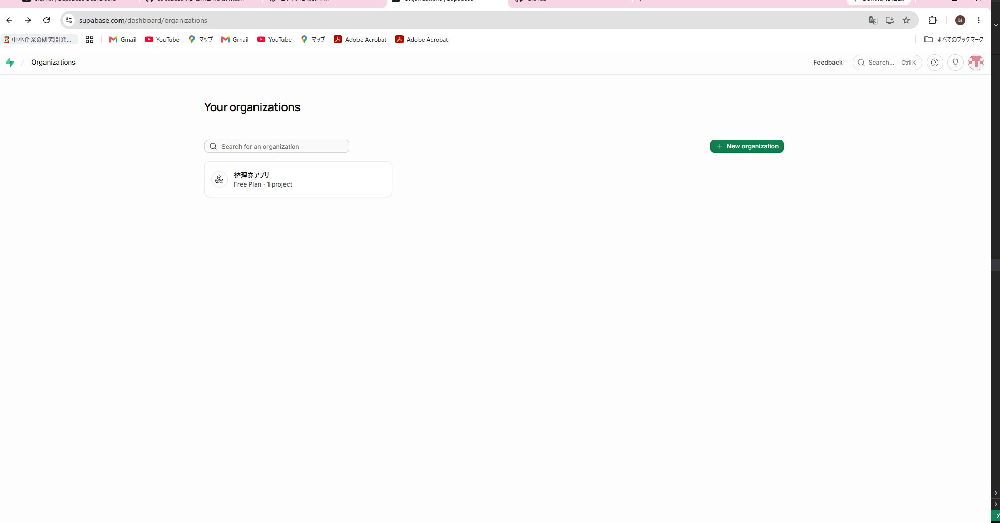
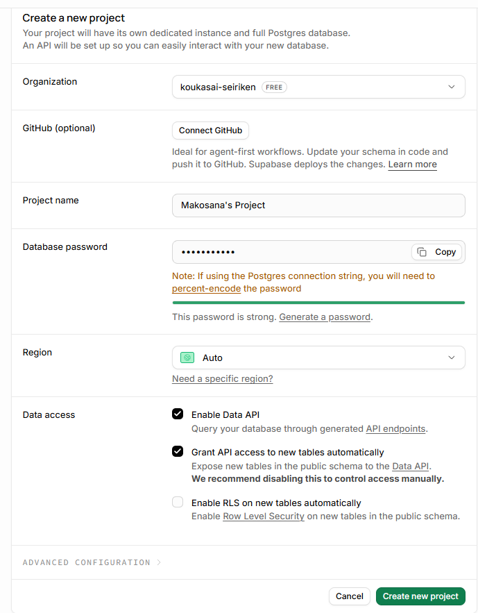
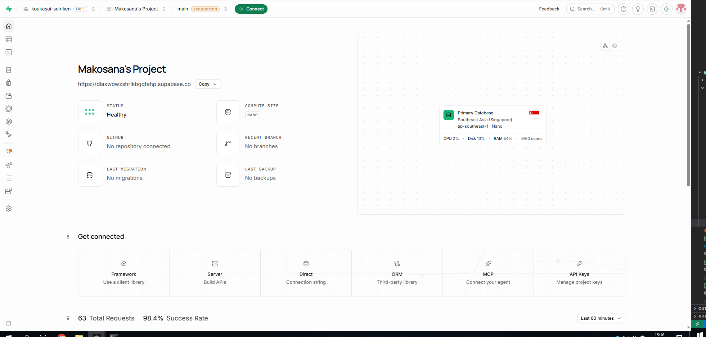
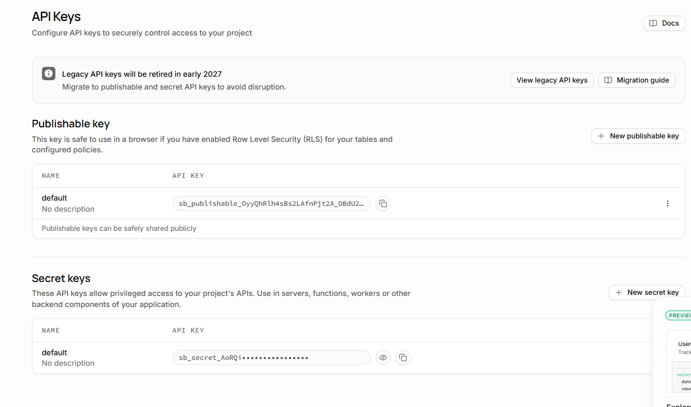

# Supabase セットアップ手順

学校用の Supabase アカウントを新しく作り、整理券アプリ（インターネット版）を使えるようにするまでの手順です。  
公開先は **cpcallgol** の GitHub Pages を前提にしています。

- 来場者用: https://cpcallgol.github.io/event-2026-festival-seiriken/
- 運営画面: https://cpcallgol.github.io/event-2026-festival-seiriken/#/admin

日常の使い方（整理券の受付・取消・コンテストなど）は `使い方説明書.md` を見てください。SQLの細かい説明は `supabase/README.md` にあります。

---

## 全体の流れ

1. Supabase でアカウントとプロジェクトを作る
2. SQL を 001 から 014 まで順に実行する
3. 取消用のパスワードを設定する
4. 接続先（URL と公開鍵）を `source/.env.online` に書く
5. `publish.bat` で画面を公開する
6. 運営画面で開催日・イベント・回を登録して確かめる

初回はだいたい 30〜40 分みてください。SQLを実行してから公開するまでの間は、古い画面からは整理券を取れなくなることがあるので、**受付をしていない時間に続けて**行ってください。

---

## 1. Supabase のアカウントとプロジェクトを作る

1. https://supabase.com を開き、アカウントを作ります（学校用のメールで大丈夫です）。
2. 「New Organization」を押します。
3. 「create a new project」でこのように設定（パスワードは自分で考えて）
4. 作成が終わるまで数分待ちます。

## 2. データベースを作る（SQLを順番に実行）

1. 左のメニューの「SQL Editor」を開き、このフォルダーの `migrations/001_init.sql` をメモ帳で開き、全文をコピーして貼り付けます。
2. 「Run」を押します。「Success. No rows returned」と出れば完了です。
   | 順番 | ファイル |
   | ---- | -------- |
   | 1 | `001_init.sql` |
   | 2 | `002_children.sql` |
   | 3 | `003_name.sql` |
   | 4 | `004_checkin.sql` |
   | 5 | `005_events_waitlist.sql` |
   | 6 | `006_cancel_checked_in.sql` |
   | 7 | `007_list_all_tickets.sql` |
   | 8 | `008_wait_blocks_overlap.sql` |
   | 9 | `009_wait_partial.sql` |
   | 10 | `010_event_kinds.sql` |
   | 11 | `011_contest.sql` |
   | 12 | `012_no_login.sql` |
   | 13 | `013_edit_party.sql` |
   | 14 | `014_contest_adjust.sql` |

3. 「Success」と出たら次のファイルへ進みます。

> **新規のプロジェクトでは、上の14個をすべて実行してください。**  
> 途中までしか実行していないときは、済んでいない番号から続けます。くわしい分岐は `supabase/README.md` にあります。  
> **010** と **011** は原則1回だけです（2回目はエラーになりますが、データは壊れません）。  
> **007〜009・012〜014** は何度実行しても大丈夫です。

運営画面にログインは不要です（012 の効果です）。スタッフ用のメールアカウントを作る必要はありません。運営画面のURLは、運営スタッフだけで共有してください。

---

## 3. 取消用のパスワードを設定する

006 を実行したあと（新規なら全部のあとも可）、SQL Editor で次の1行を実行します。  
`1234567` の部分を、本当の **7桁の数字** に書きかえてから「Run」を押してください。

```sql
select private.set_cancel_password('1234567');
```

「取消用のパスワードを設定しました。」と出たら完了です。

- 受付済みの整理券の取消、人数の修正、コンテストの調整点で使います。
- **この数字は、どのファイルにも書かないでください**（GitHub に公開されるためです）。責任者だけが覚えておきます。
- 変えたいときは、同じ1行を新しい7桁で実行し直します。

---

## 4. 接続先を書く（`source/.env.online`）

1. 次の2つを控えます。
   - project overviewから**project url**（`https://xxxx.supabase.co` の形）
   - Supabase の **「Project Settings」→「API」**（または「API Keys」）を開きます。**anon public key**（ `sb_publishable_...` ）
2. `source/.env.online.example` をコピーして、同じ場所に **`source/.env.online`** という名前で作ります。
3. 控えた2つを書き込みます。例：

```
VITE_SUPABASE_URL=https://xxxx.supabase.co
VITE_SUPABASE_ANON_KEY=ここに公開鍵を貼り付け
```

- anon / publishable key は、来場者のスマホにも届く **公開してよい鍵** です。
- **service_role key（secret key）は絶対に書かないでください。**
- `.env.online` は Git に入りません（`.gitignore` 済みです）。

---

## 5. 画面を公開する（cpcallgol）

プロジェクト直下の **`publish.bat` をダブルクリック**してください。

1. 画面の作り直し（ビルド）
2. cpcallgol の GitHub Pages への送信

まで自動で行います。初めてのときは GitHub のログイン画面が出ることがあります。  
**cpcallgol のリポジトリに書き込めるアカウント** でログインしてください。

終わると、次のURLが使えます。

- 来場者用: https://cpcallgol.github.io/event-2026-festival-seiriken/
- 運営画面: https://cpcallgol.github.io/event-2026-festival-seiriken/#/admin

> `.env.online` を書き換えたあとは、必ずもう一度 `publish.bat` を実行してください。古い公開鍵のままでは、新しいプロジェクトにつながりません。
>
> 「このPCにはビルド環境がないため…」と出たときは、画面は作り直されていません。開発担当の人に「ビルドして」と頼んでから、もう一度 `publish.bat` を押してください。
>
> 「cpcallgol には送れませんでした」と出たときは、このPCでログインしている GitHub アカウントに書き込み権限があるか確かめてください。

（参考）同じ `publish.bat` は makosana 側にも送ろうとしますが、学校用の本番は **cpcallgol** を使います。makosana が失敗しても、cpcallgol だけ成功していれば本番は使えます。

---

## 6. 使えるか確かめる

1. 運営画面（上のURL + `#/admin`）を開きます。ログインは不要です。
2. **「イベントと回」** で開催日・イベント・回を登録します（くわしくは `使い方説明書.md` の4章）。
3. 来場者用のURLを開き、整理券が取れることを確かめます。
4. 運営画面の **「掲示用QR」** を印刷します。QRには、いま開いているページのURLが入ります。
5. コンテストを使うときは、運営画面の **「コンテスト」** で出場者と投票時間を確認します。

このPCだけで先に試したいときは、親フォルダーの **「オンライン版を試す.bat」** でも開けます（スマホからは開けません。データは本物の Supabase に保存されます）。

---

## 本番前の注意

- 無料プランは、**だいたい1週間使わないと一時停止**します。本番の数日前と前日に Supabase の管理画面を開き、止まっていたら **「Restore」** を押してください。
- リハーサルの整理券を消して本番を迎えたいときは、`使い方説明書.md` の10章「データを全部消す」を見てください。
- 終わったら、運営画面の「集計・出力」から CSV を手元に残してください。
- 地図アプリの整理券用QRも、来場者用URL（cpcallgol）を指すようにしてください。

---

## うまくいかないとき

| 症状                                     | 確認すること                                                                                              |
| ---------------------------------------- | --------------------------------------------------------------------------------------------------------- |
| 運営画面でログインを求められる           | `012_no_login.sql` を実行したか                                                                           |
| 整理券が取れない・エラーになる           | SQL が 014 まで済んでいるか。`.env.online` のURL・鍵が今のプロジェクトか。そのあと `publish.bat` をしたか |
| 取消や人数修正・調整点でパスワードエラー | 手順3の取消用パスワードを、今のプロジェクトで設定したか                                                   |
| 画面が古い                               | `publish.bat` をもう一度実行する。GitHub Pages の反映に1〜2分かかることがあります                         |
| Supabase が応答しない                    | プロジェクトが一時停止していないか（Restore）。インターネットにつながっているか                           |

くわしいトラブルシューティングは `使い方説明書.md` の12章を見てください。
